

  

  A complete browser version of my local desktop theme studio for users of the Innioasis Y1 mp3 player. Create new themes, import existing themes, edit every active theme option, use the built-in image tools, and preview everything inside an interactive physical Y1 without downloading and installing an application.

  
  
  
  
  

  Available to <strong>free members</strong> and paid Patreon members. No purchase is necessary.

  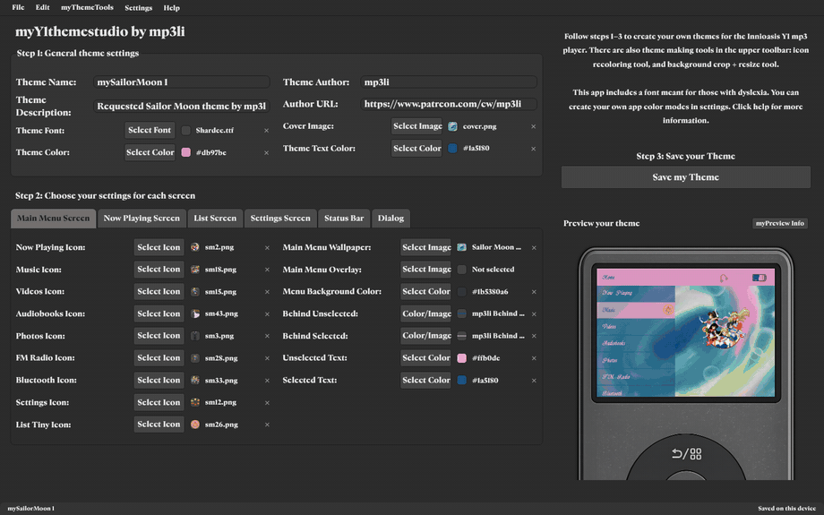
   
  A walkthrough of the website tabs used to edit different Y1 screens, shown with themes made by mp3li: Sailor Moon (with its second screen in Cute Mode), Mount Rainier National Park (in Light Mode), Twilight, Kiki's Delivery Service, Miffy, and Digital Vinyl Store.

### Table of Contents:

<em>Open Table of Contents</em>

- [What This Website Does](#what-this-website-does)
- [Requirements](#requirements)
- [How to Use myY1themestudio](#how-to-use-myy1themestudio)
- [Full Feature List with Website Screenshots](#full-feature-list-with-website-screenshots)
  - [Welcome Screen](#welcome-screen)
  - [Theme Creation and Import](#theme-creation-and-import)
  - [General Theme Settings](#general-theme-settings)
  - [Main Menu Screen](#main-menu-screen)
  - [Now Playing Screen](#now-playing-screen)
  - [List Screen](#list-screen)
  - [Settings Screen](#settings-screen)
  - [Dialog Screen](#dialog-screen)
  - [Status Bar and Device Indicators](#status-bar-and-device-indicators)
  - [Y1 Preview Area](#y1-preview-area)
  - [Mobile Layout](#mobile-layout)
  - [Assetbank Workflow](#assetbank-workflow)
  - [Save and Packaging Workflow](#save-and-packaging-workflow)
  - [Built-in Tools](#built-in-tools)
  - [Settings System and Modes](#settings-system-and-modes)
  - [Help and Menu Actions](#help-and-menu-actions)
- [Fonts](#fonts)
- [Security, Privacy, and Safe File Handling](#security-privacy-and-safe-file-handling)
- [Technical Specs](#technical-specs)
- [Links](#links)

--------------------------------------------------

### What This Website Does:

- Creates empty, organized Y1 themes with the required folder structure and `config.json`, ready for users to make a new theme.
- Imports existing Y1 theme ZIPs and folders for editing.
- Includes **all active theme options from the desktop app**, including icons, backgrounds, colors, fonts, status states, and more through six on-screen tabs: Main Menu, Now Playing, List, Settings, Status Bar, and Dialog.
- Features my realistic Y1 device artwork with a live preview placed inside the screen cutout.
- Keeps the Y1 preview interactive. Click menu rows, list rows, Settings rows, and Dialog options to see selected, unselected, and cycling states.
- Features an optional `assetbank` with `used` and `unused` folders.
  - Theme assets include icons, backgrounds, overlays, and other artwork used while making a theme.
  - Assets selected for the theme move into `assetbank/used`.
  - Assets that are no longer selected move back into `assetbank/unused`.
  - This keeps large collections of theme artwork organized and prevents users from losing track of which files are already active.
- Includes a built-in background crop and resize tool.
  - Import an image or choose one already in the theme.
  - Crop it to the Y1 screen shape and resize it to exactly 640×480 PNG.
  - Includes crop movement, image movement, four resize corners, coordinate controls, zoom, and sharpening.
- Includes a built-in image recolor tool.
  - Click a connected color region and choose a replacement color.
  - Includes transparency handling, color tolerance, single-color image support, Continue Recoloring, Undo, Redo, Apply, Done, and Cancel.
- Includes a custom color picker with a basic color palette, full hue/saturation area, dark/light and transparency controls, numeric RGB entry, hexadecimal entry, previous/current colors, photo palette extraction, and a saved draggable color palette.
- Includes Clean Up Unused Assets in Theme Folder.
  - Removes unreferenced binary files from the browser working project.
  - Keeps active theme files, text files, license files, protected files, and the assetbank.
  - Can be undone before leaving the current project.
- Includes Zip Theme for Sharing.
  - Packages the theme using the desktop app's theme/author naming convention.
  - Leaves the development assetbank out of the sharing ZIP.
- Includes downloadable editable project backups that retain the assetbank.
- Includes optional direct folder saving in browsers that support it.
- Includes browser autosave and a Resume button for the last working project.
- Preserves unknown imported configuration fields instead of removing data the editor does not recognize.
- Includes Dark Mode, Light Mode, Cute Mode, custom appearance profiles, bundled interface fonts, local font loading, and OpenDyslexic support.
- Adapts the same studio for mobile screens with the Y1 preview above the editor and collapsible general settings.
- Keeps the desktop-disabled Icon Centering Tool unavailable.
- Guides all skill levels through the same three visible steps: general theme settings, per-screen settings, and saving the finished theme.
- For the complete button and workflow list, open the Full Feature List lower in this README.

--------------------------------------------------

### Requirements:

<em>Open Requirements</em>

#### What regular users should expect:

- A current desktop or mobile web browser.
- JavaScript enabled.
- Enough local browser storage for the theme currently being edited.
- No Python installation.
- No Qt installation.
- No application installer.
- No operating-system code-signing or certificate prompt.
- No account or login.

#### How this website is provided:

- The production release will be a static browser website.
- ZIP import and ZIP download are the portable workflow across browsers.
- Direct folder saving is an additional browser-dependent option.
- The website does not need a server database, theme-upload API, or account system.

#### Browser requirements list:

- Chromium, Firefox, or Safari/WebKit-based browser.
- File download permission.
- Local browser storage for autosave and appearance preferences.
- Folder-selection permission only when using folder import or optional direct folder saving.

#### Notes:

- Theme editing, image processing, archive handling, and project storage happen in the browser.
- Keep downloadable editable backups. Clearing browser data can remove the browser's saved working project.
- The ZIP workflow remains available even when direct folder saving is not supported.

--------------------------------------------------

### How to Use myY1themestudio:

- The website is available through Patreon to **free members** and paid Patreon members. No purchase is necessary.

- Follow the three on-screen steps:
  - Step 1: create a new theme or import an existing theme ZIP/folder, then complete the general theme settings.
  - Step 2: configure assets and colors across the Main Menu, Now Playing, List, Settings, Status Bar, and Dialog tabs.
  - Step 3: preview the theme, save an editable backup, clean up unused files, or package the theme for sharing.
- Use `myThemeTools` when an image needs recoloring, cropping, resizing, or sharpening.
- Keep an editable project backup when the assetbank or future editing work needs to be retained.

For detailed information on every area and workflow, open the Full Feature List below.

--------------------------------------------------

### Full Feature List with Website Screenshots:

<em>Open Full Feature List with Website Screenshots</em>

#### Welcome Screen:

- Intro summary of what the studio does.
- Studio Appearance selector that shows the currently active mode.
- `Create New Theme`.
- `Edit Existing Theme ZIP`.
- `Edit Existing Theme Folder`.
- `Resume` when the browser has a saved working project.
- Settings and Help / About controls.

  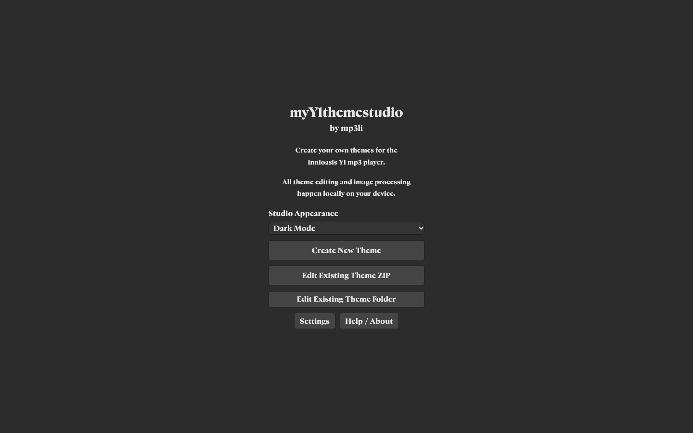
   
  The welcome screen in Dark Mode.

#### Theme Creation and Import:

- Creates a new theme using the original Y1 configuration template and 47-folder scaffold.
- Imports existing theme ZIPs.
- Imports existing theme folders through the browser's folder-selection workflow.
- Includes missing-config recovery for incomplete imports.
- Reports missing or unreadable referenced assets instead of silently replacing them.
- Preserves unrecognized configuration fields.
- Keeps the original imported files unchanged while edits happen inside the browser working project.

#### General Theme Settings:

- Theme Name.
- Theme Description.
- Theme Font.
- Theme Color.
- Theme Text Color.
- Cover Image.
- Theme Author.
- Author URL.

#### Main Menu Screen:

- Main menu wallpaper.
- Main menu overlay.
- Now Playing, Music, Videos, Audiobooks, Photos, FM Radio, Bluetooth, and Settings icons.
- Menu background color.
- Selected and unselected item backgrounds.
- Selected and unselected text colors.
- Tiny arrow icon mapping.

  
   
  mySailorMoon 1 by mp3li is the first full studio example.

#### Now Playing Screen:

- Now Playing wallpaper/background mapping.
- Text and progress colors.
- Progress bar background and text colors.
- Now Playing-specific preview behavior.
- Physical Y1 preview using the selected theme artwork.

#### List Screen:

- Selected and unselected list item text colors.
- Selected and unselected row backgrounds.
- List tiny icon.
- Folder-view music icon.
- Folder-view folder icon.
- Interactive selected-row behavior in the Y1 preview.

#### Settings Screen:

- All active Settings icon mappings from the desktop app.
- Multiple editing pages so the large icon set remains manageable.
- Selected and unselected list behavior.
- Multi-icon cycling behavior for applicable Settings items.
- Next-page controls for the stacked Settings editing sections.

  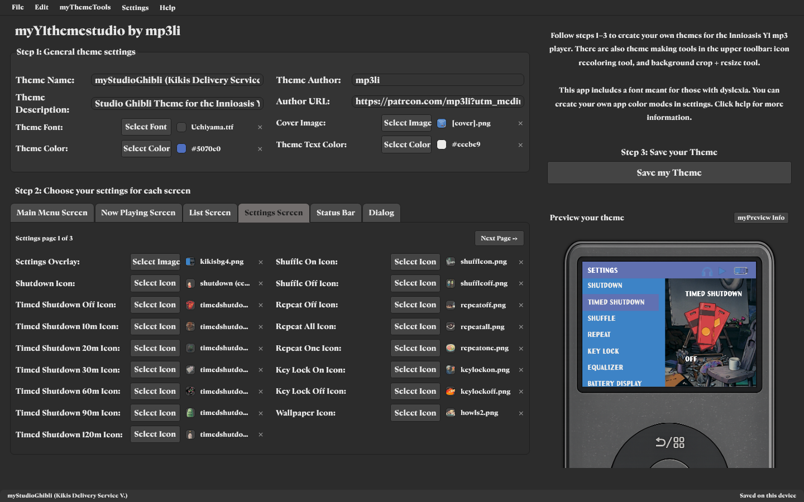
   
  myStudioGhibli (Kiki's Delivery Service Version) by mp3li in the Settings editor.

#### Dialog Screen:

- Dialog text color.
- Selected and unselected option text colors.
- Dialog background.
- Selected and unselected option backgrounds.
- Interactive yes/no option selection in the preview.

  
   
  myTwilightSaga Theme by mp3li showing the Dialog preview state.

#### Status Bar and Device Indicators:

- Music, audiobook, FM radio, paused, and stopped indicators.
- Bluetooth connecting, connected, and disconnected indicators.
- Headset with microphone and headset without microphone indicators.
- Four battery states.
- Four battery-charging states.
- Status bar color.
- The website uses color for the status-bar background because the Y1 firmware does not support a status-bar background image.

#### Y1 Preview Area:

- Uses my original physical Y1 artwork and transparent screen cutout.
- Uses the desktop app's device-body proportions, shadow, preview geometry, image layering, icon bounds, text placement, and 321×231 logical screen coordinate system.
- Updates while theme fields change.
- Scales the Y1, screen, and interaction coordinates together.
- Keeps preview state separate from the exported theme configuration.
- Supports clickable Main Menu, List, Settings, and Dialog selections.
- Rises from the lower edge and crops around the center clickwheel control, matching the intended desktop composition.

  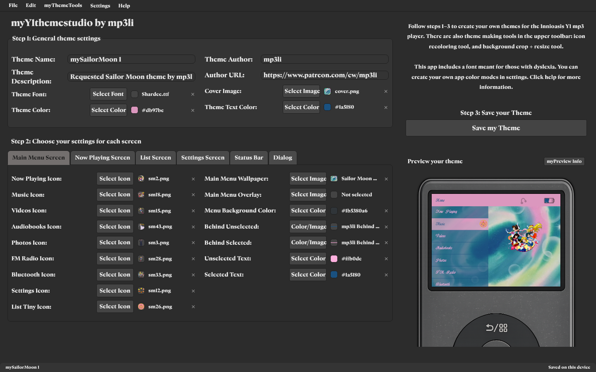
  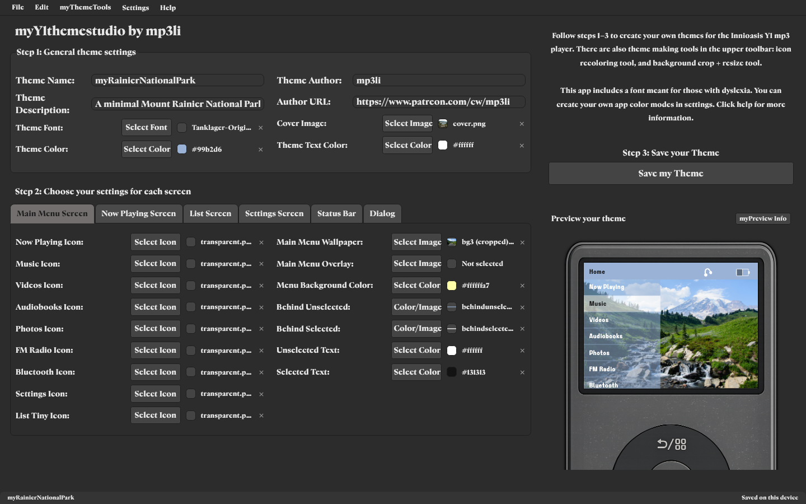
   
  Sailor Moon and Mount Rainier National Park themes by mp3li.

  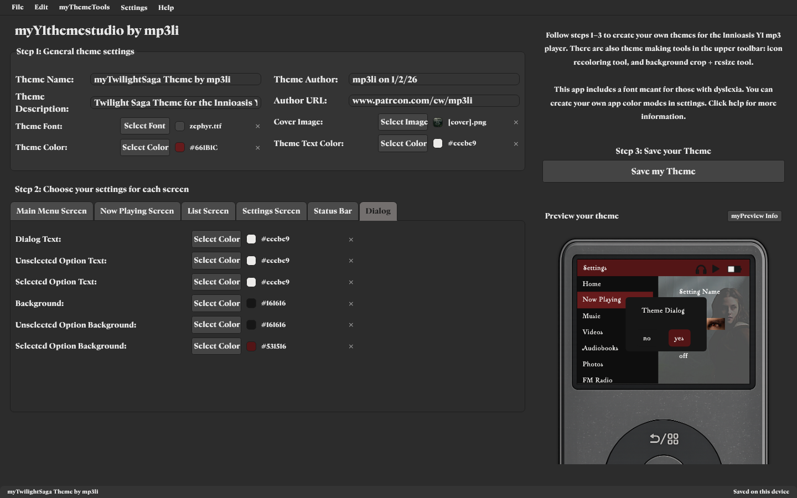
  
   
  Twilight and Kiki's Delivery Service themes by mp3li.

  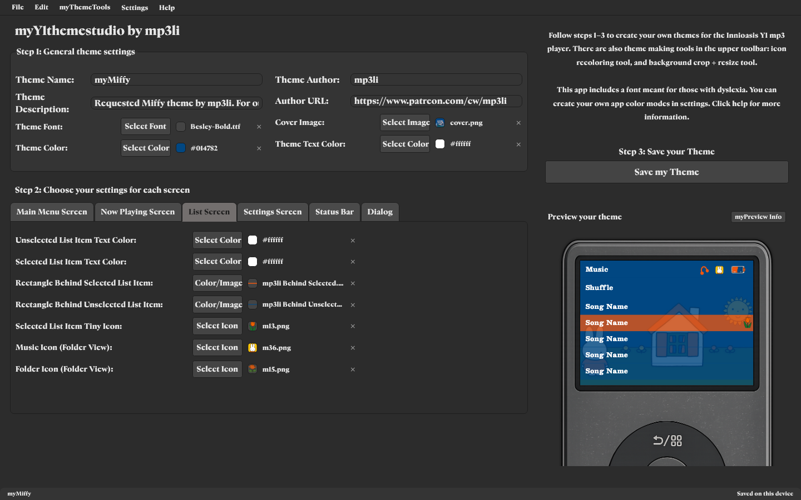
  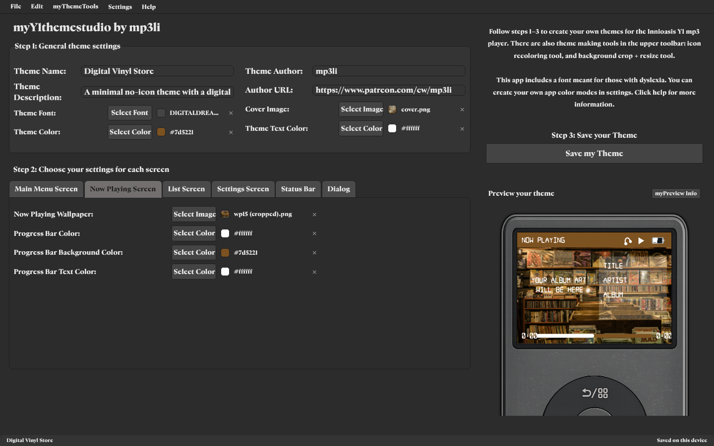
   
  Miffy and Digital Vinyl Store themes by mp3li.

#### Mobile Layout:

- Keeps the same editor and theme model instead of replacing it with a separate simplified app.
- Places the Y1 preview above the editor.
- Makes general theme settings collapsible.
- Retains all six screen tabs.
- Adapts fields, tools, and dialogs to the available width.

  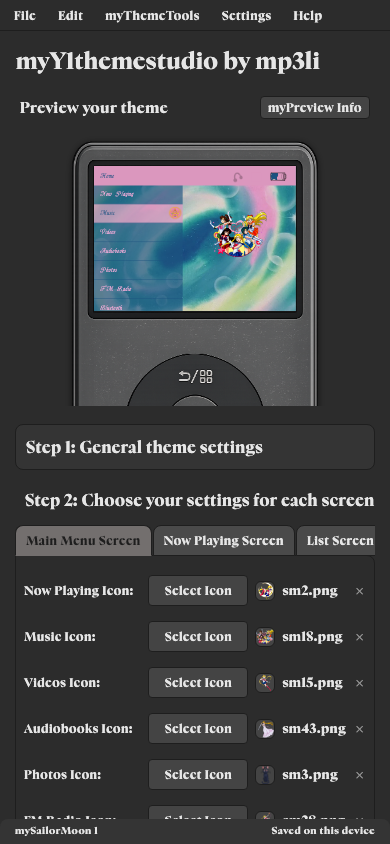
  &nbsp;&nbsp;&nbsp;&nbsp;
  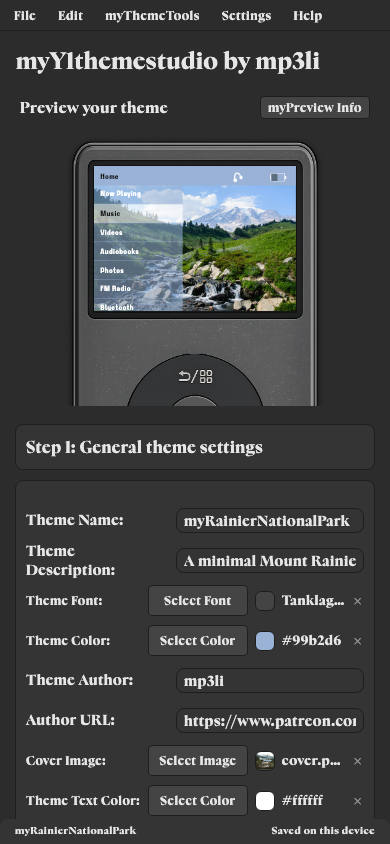
   
  Sailor Moon preview and Mount Rainier National Park general settings.

  

  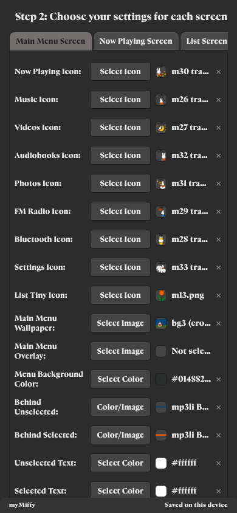
  &nbsp;&nbsp;&nbsp;&nbsp;
  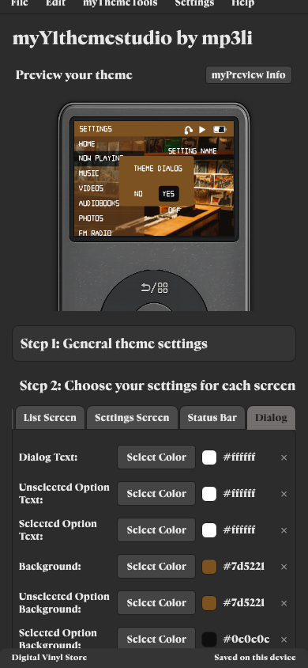
   
  Miffy screen editing and the Digital Vinyl Store Dialog editor.

#### Assetbank Workflow:

- Supports `assetbank/used` and `assetbank/unused`.
- Moves selected artwork into used and unreferenced artwork back into unused.
- Uses configuration-aware references and SHA-256 matching.
- Shows the current asset and pending replacement before applying a change.
- Lets users choose a new local file or an existing image from the theme.
- Replacing a file at an existing destination updates every field sharing that path, matching the desktop app.
- Keeps import-time duplicate-name handling separate so distinct imported files are not accidentally destroyed.

#### Save and Packaging Workflow:

- Browser autosave and Resume.
- Download Editable Project Backup, including the assetbank.
- Package Theme for Sharing, excluding the assetbank.
- Clean Up Theme Folder for Y1.
- Optional direct folder saving in supported browsers.
- Preserves Y1 paths, unknown imported config fields, license files, and protected text files.
- Reports storage and file-operation failures instead of claiming a save succeeded early.

#### Built-in Tools:

##### Background Crop and Resize Tool:

- Loads a new image or an existing image from the working theme.
- Uses a fixed 4:3 crop.
- Supports crop movement, image movement, four resize corners, zoom, sharpening, and coordinate entry.
- Uses the desktop app's sharpening kernel and staged Lanczos resizing behavior.
- Produces an exact 640×480 PNG.
- Downloads the processed image or saves and applies it to the working project.
- Runs in a dedicated browser worker and supports cancel/retry.

  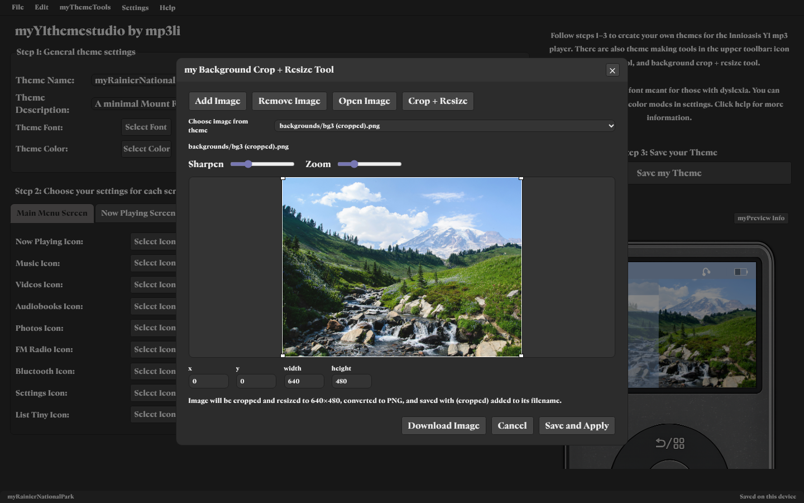
   
  A Mount Rainier National Park theme background inside the crop and resize tool.

##### Image Recolor Tool:

- Selects connected image regions.
- Uses the desktop app's color tolerance and single-color behavior.
- Leaves fully transparent background pixels untouched.
- Supports replacement transparency exactly as the Python app does.
- Includes Continue Recoloring, Undo, Redo, Apply, Done, and Cancel.
- Downloads a PNG or saves it into the theme project.

  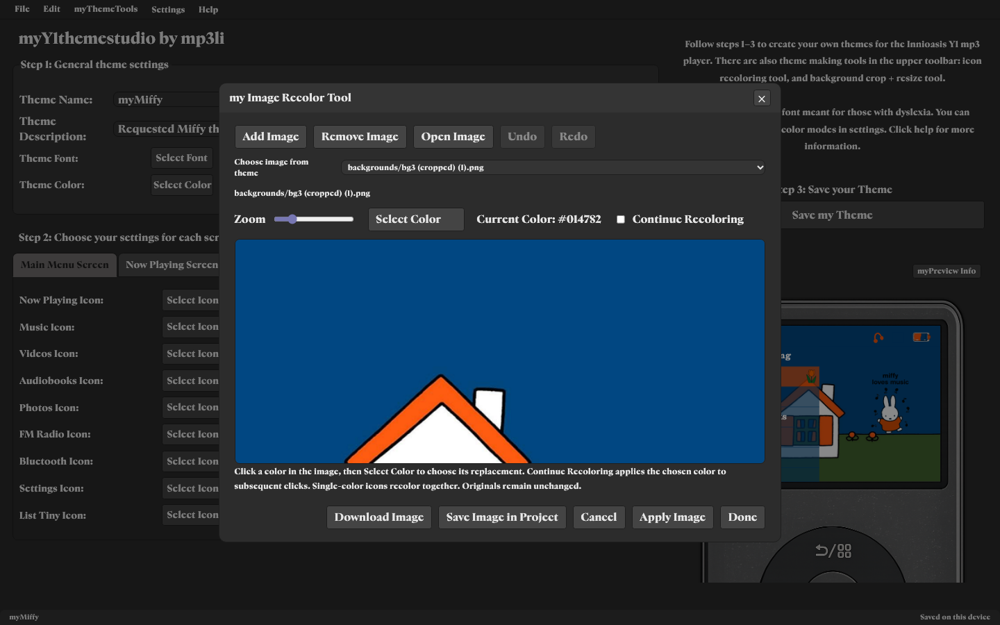
   
  A Miffy theme background with its blue region selected in the recolor tool.

##### Cleanup and Sharing Tools:

- Clean Up Unused Assets in Theme Folder removes unreferenced binary files while keeping text, licenses, protected files, and the assetbank.
- Zip Theme for Sharing creates a clean package without the assetbank.
- Cleanup affects only the browser working project until the user explicitly downloads or saves it.

#### Settings System and Modes:

- Full studio appearance settings window.
- Dark Mode.
- Light Mode.
- Cute Mode.
- Settings Profile selector displays the current active mode.
- Custom colors for text, main background, panels, buttons, button text, borders, accent, highlight, and toggle state.
- Custom profile save/update and delete controls.
- App-font selection.
- Optional installed-font listing when browser support and permission are available.
- Local font-file loading.
- OpenDyslexic shortcut that restores the previous font when disabled.
- Custom font/color changes preview before Done; Cancel discards the draft.
- Selecting a built-in mode applies it immediately, matching the desktop app.

  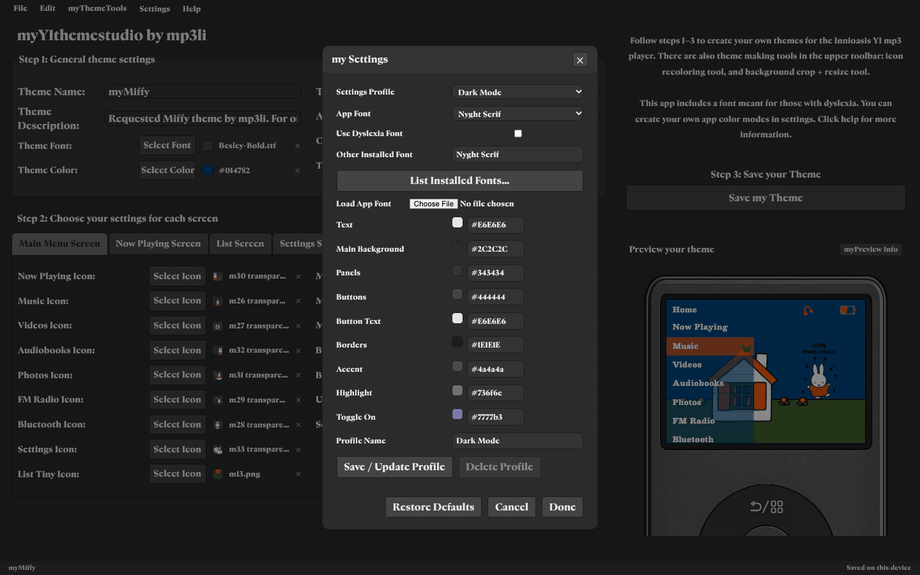
   
  Dark Mode, Light Mode, and Cute Mode with myMiffy by mp3li open behind Settings.

  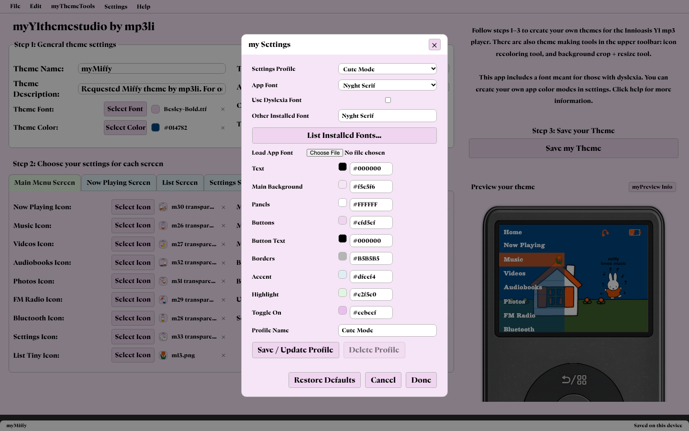

#### Help and Menu Actions:

- File menu.
- Edit menu with Undo and Redo.
- myThemeTools menu.
- Settings.
- Help.
- myPreview Info.
- GitHub and Patreon links in Help / About.
- myY1archive marked coming soon.

--------------------------------------------------

### Fonts:

<em>Open Fonts</em>

- **Nyght Serif**
  - Default studio font and the font used for the README title image.
  - Designed by Maksym Kobuzan.
  - Distributed under the SIL Open Font License in this project.
- **Paysage**
  - Optional studio interface font.
  - Designed by Anton Moglia.
  - Distributed under the SIL Open Font License in this project.
- **Tanklager**
  - Optional studio interface font.
  - Designed by Ariel Martín Pérez.
  - Distributed under the SIL Open Font License in this project.
- **OpenDyslexic**
  - Included as an optional accessibility-focused interface font.
  - Copyright Abbie Gonzalez.
  - Distributed under the SIL Open Font License in this project.

The public repository includes the license and creator notice for every bundled interface font: [Nyght Serif](font-licenses/Nyght-Serif/LICENSE.txt), [Paysage](font-licenses/Paysage/LICENSE.txt), [Tanklager](font-licenses/Tanklager/LICENSE.txt), and [OpenDyslexic](font-licenses/OpenDyslexic/LICENSE.txt). The font files themselves are served by the website and are not included in the public showcase repository. Theme fonts imported by users stay in their local working theme.

--------------------------------------------------

### Security, Privacy, and Safe File Handling:

- Theme files, image processing, ZIP creation, and working-project storage stay on the user's device.
- The studio does not require an account and does not upload themes to a server or save them in a remote database.
- Imported archives are checked for unsafe paths before their contents enter the browser workspace.
- Unknown Y1 configuration fields are preserved, while missing or unreadable assets are reported instead of silently replaced.
- Original imported files are not changed. Cleanup and editing affect only the browser's working copy until the user explicitly saves or downloads a result.
- Autosave is paired with downloadable editable backups so users can keep control of their work outside browser storage.
- Public release files are reviewed for credentials, private workstation paths, unapproved source material, and unexpected binary changes before publication.
- Theme examples in this README are rendered previews of themes made by mp3li; the source theme folders, assetbanks, and private theme fonts are not included.

--------------------------------------------------

### Technical Specs:

<em>Open Technical Specs</em>

- Application type: browser-based theme studio.
- Supported workflows: theme ZIP import/export, folder import, editable project backups, and optional direct folder saving where the browser supports it.
- Browser support target: current Chromium, Firefox, and Safari/WebKit-based browsers.
- Image processing: local browser workers so intensive crop, resize, sharpen, and recolor operations do not freeze the editor.
- Crop output: exact 640×480 PNG.
- Preview system: interactive Y1 device preview with a fixed internal coordinate system that scales with the interface.
- Project persistence: local browser storage with explicit downloadable backups.
- Availability: free and paid Patreon members.
- Accounts, remote theme storage, and theme-upload services: not used.

--------------------------------------------------

### Links:

- Patreon: <https://www.patreon.com/cw/mp3li>
- Website Portfolio: <https://elichristmas.dev>

--------------------------------------------------
